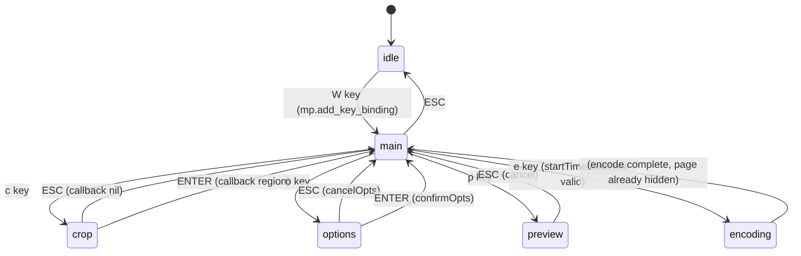

# 09 — State Machines and UI

**Source hash**: sha256:3f454dc0ca030b591d659f7405a3ddfdf7585e5b5eb4cd5b3a573b4151b33214
**Generation date**: 2026-11-15

See `re-workspace/guilds/ui-state/ui-state.md` for the complete state machine.

## Page State Machine (Mermaid)



## Per-Page Key Bindings

### MainPage
c=crop, 1=setStart, 2=setEnd, o=options, p=preview, e=encode, ESC=hide

### CropPage
1=pointA, 2=pointB, r=reset, ESC=cancel, ENTER=finish

### EncodeOptionsPage
UP/DOWN=navigate, LEFT/RIGHT=change value, ENTER=confirm, ESC=cancel

### PreviewPage
ESC=cancel and restore

## Page Lifecycle

```
show(): visible=true → add_keybinds → observe_properties → prepare → draw
hide(): visible=false → remove_keybinds → unobserve_properties → dispose → clear
```

## Render Trigger Events

1. Any key press → action method → explicit draw() call
2. OSD size change → sizeCallback → draw()
